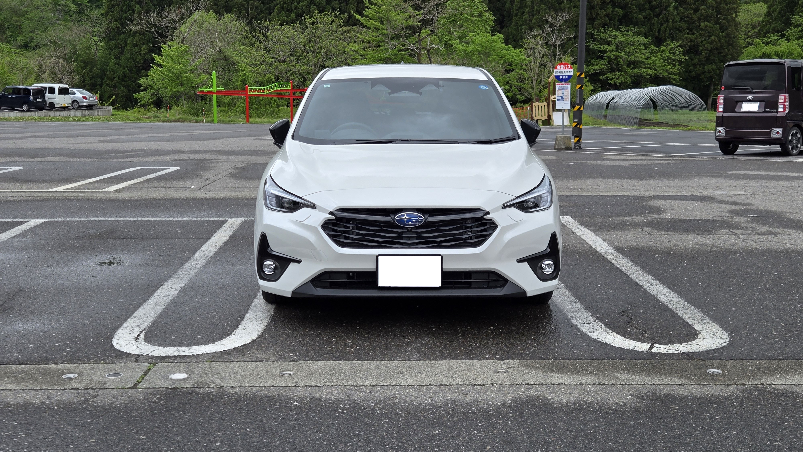
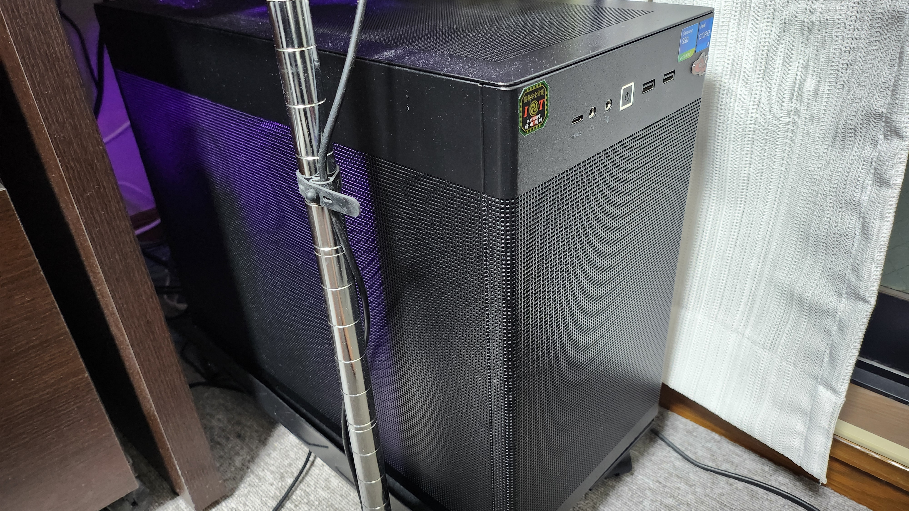

# 管理者 (Kuropen) プロフィール
1989年8月生まれ。埼玉県さいたま市 (旧大宮市)、福島県会津若松市出身。現在埼玉県さいたま市 (旧与野市) 在住。

## 来歴
福島県立会津高等学校、会津大学コンピュータ理工学部卒業。卒業研究の一環としてパソコン甲子園の運営に関わる。

大学発ベンチャーにてメールアプリのスキン作成用Webアプリ、マスメディアのサブスク会員向けAndroidアプリ、ジオフェンシングサービスの管理用Webインターフェイスなどの制作受託に従事したのち、
現在は人材サービス企業向けの求人応募用Webシステムの制作に携わっている。

## 趣味
- 一人旅 (街歩き・寺社巡り)
- ドライブ
- モータースポーツ観戦 (主に F1, Formula E)
- シミュレーションゲーム
  - かつてはオンラインを含むRPGもやっていたものの、2025年春頃から多忙のため実質休止中。

## 持ち物

### 車

スバル・インプレッサ (GU7, ST Black Selection AWD) を2026年5月より運用。2ヶ月に1回程度さいたま市と会津若松との往復で使うなどしている。

### PC・端末
- スマートフォン: Galaxy Z Flip 6
- タブレット: Galaxy Tab S10 FE

#### 自作PC
2022年12月に組み直した2代目自作PCを運用中。

- ケース: ASUS PRIME AP201 (2023年6月交換)
- マザーボード: MSI MAG B660M BAZOOKA
- CPU: Intel Core i5 12400F
- メモリ: 32GB (DDR4-3200 16GBx2)
- SSD: 1TB (Crucial P5 NVMe PCIE4x4) + 1TB (SAMSUNG 860 QVO SATA)
- GPU: NVIDIA GeForce RTX 5070 (ASUS DUAL-RTX5070-O12G) (2026年7月交換)
- モニター: OMEN by HP 27i (2024年6月に導入した中古品)
- キーボード: REALFORCE R3HA12
- マウス: Logicool M720
- サウンドカード: CREATIVE SoundBlaster GC7
- スピーカー: EDIFIER R12U
- Webカメラ: Lenovo エッセンシャル FHD Webカメラ (顔認証対応)
- ヘッドホン: Audio-Technica ATH-GL3
- ゲームパッド: RAZER WOLVERINE V2

この端末で [Folding@home に参加しています](https://stats.foldingathome.org/donor/391936600)。  
 (運用時間: 11月から2月までの 23:00 から翌 8:00 まで。不在時・電力逼迫時を除く)

#### モバイルノート

- 機種名: ThinkBook 14 Gen 8
- CPU: Intel Core Ultra 5 225H
- メモリ: 32GB (DDR5-5600 16GBx2)
- SSD: 1TB
